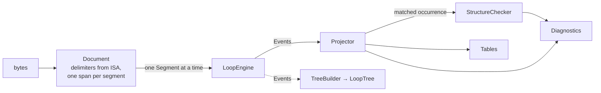

# Architecture

A ten-minute map of the code for contributors. For using oxedi, read the
[README](README.md) and the [guides](docs/index.md); for how to build, test and send a change,
read [CONTRIBUTING.md](CONTRIBUTING.md).

## What oxedi is

oxedi reads X12 835 remittance files into typed tables and writes tables back into an 835. The
core is a Rust library with no I/O; Python, DuckDB and the browser viewer are thin bindings over
it. One promise shapes everything: **every input byte lands in exactly one segment's raw bytes,
and nothing is dropped**. Input the parser does not understand is kept and reported as a
diagnostic, never skipped.

The structure of the 835 is data, not code. Loops, segments, tables and balancing rules live in
a JSON spec (`crates/oxedi_core/specs/835.json`). No code in the core is specific to the 835
beyond loading that file, and the Rust bindings and the viewer name no 835 segment.

| Crate | What it is | Depends on |
|---|---|---|
| `crates/oxedi_core` | The parser, checker, projector and writer. Sans-IO: bytes in, values out. | `serde`, `serde_json`, `hmac`, `sha2` |
| `crates/oxedi_py` | The Python package `oxedi` (Rust in `src/`, Python in `python/oxedi/`). | core, `pyo3`, `arrow-*` |
| `crates/oxedi_duckdb` | The DuckDB extension `oxedi`, on DuckDB's C API. | core, `libduckdb-sys` |
| `crates/oxedi_wasm` | The WebAssembly module of the viewer in `viewer/` (plain JS, no build step). | core, `wasm-bindgen` |

Start reading at the `//!` header of `crates/oxedi_core/src/lib.rs` (one paragraph per layer),
then `crates/oxedi_core/src/process/mod.rs` (where the layers meet). Every core folder's
`mod.rs` lists what each of its files holds.

## Pipelines

### Reading: bytes to tables and diagnostics

1. `Document::parse` (`document/`) reads the delimiters from the ISA header
   (`Delimiters::from_isa_after_leading_trivia`, `delimiters/`, which splits off the leading
   byte order mark and whitespace with `trivia/`), then cuts the input into frames (`frame/`),
   one per segment. It keeps the input and one span per segment; a segment
   is parsed only when asked for. `Tokenizer` (`tokenizer/`) yields the same segments lazily,
   for streaming.
2. A `Segment` (`segment/`) is the id, the elements and `raw`: every byte from the end of the
   previous segment to its own terminator, trivia (line breaks, a byte order mark) included.
   Concatenating every `raw` gives the input back.
3. `LoopEngine` (`engine/`) is a state machine driven by the spec. For each segment it emits
   `Event`s: `LoopOpened`, `LoopClosed`, `Captured`, `Unmatched`, `Empty`.
4. `Processor` (`process/`) feeds each segment to the engine, then hands the events to the
   projector and the checker. `Processor::run` does this over a whole `Document`.
   - `Projector` (`project/`) finds which occurrence of its loop the segment matched, checks
     every element the spec defines (`project/check.rs`: required, type, length, code list,
     components) and fills the spec's tables (`project/fill.rs`).
   - `StructureChecker` (`check/`) reports unknown segments, implicit and unterminated loops,
     envelope counts and control numbers (`check/mod.rs`), occurrence counts and order
     (`check/occurrences.rs`) and amounts that do not balance (`check/balance.rs`).
5. The result is `Tables` (`column/`: Arrow-shaped columns, each row pointing at the row of the
   table that encloses it) and a `Vec<Diagnostic>` (`diagnostic/`). `summarize` (`summary/`)
   computes the summaries the spec declares (`Spec::summaries`) over those tables.

**The order inside `Processor::feed` is a contract.** The projector runs first, because it
works out which occurrence the segment matched, and the checker reuses that match
(`Projector::matched` → `StructureChecker::on_matched`). The checker's diagnostics still come
first in `Output`, then the projector's. When a `Mask` is set, the projector masks the datum of
every diagnostic about a place a patient-data column reads, the checker's included, before they
leave the processor. Change this order and the goldens change.

The loop tree is not built by the processor. A caller that wants it folds the events into a
`TreeBuilder` in the same pass (the viewer does, in `crates/oxedi_wasm/src/view/mod.rs`) or
calls `LoopTree::build`.

Which spec reads a file: the bindings call `Builtin::select` (`spec/builtin.rs`), which picks the
built-in spec from the version the file declares in `GS08` (sharing the choice code of
`Spec::select`, `spec/version.rs`) and falls back to `Builtin::fallback`; `Builtin::find` looks one
up by transaction and version.

### Writing: tables to bytes

`write::write_with_findings` (`write/writer.rs`) runs two phases.

- **Compile the plan.** `WritePlan::new` (`write/build.rs`) inverts every table column into
  "where does this element's value come from". The plan depends only on the spec, but it is
  built at the start of each call. A spec that cannot be written is refused with a `PlanError`
  holding every `Refusal` (`write/refusal.rs`).
- **Write the tables.**
  1. `bind` (`write/data.rs`) matches the caller's tables and columns to the spec's.
  2. `nest` (`write/nest.rs`) nests the rows under their parent rows by their reference columns.
  3. `Layout::new` (`write/layout.rs`) works out the order of segments and loops.
  4. `Emitter::run` (`write/emit.rs`) walks the loops and writes the bytes, recording which
     cell each written element came from.
  5. The written bytes are read back with `Processor::run`. Every diagnostic of that read
     becomes a `Finding::ReadBack` whose `ValueOrigin` names the cell, row or envelope field
     behind it, when it can be traced (`write/finding.rs`).

`write/mod.rs` lists what every file of the folder holds.

`write::write` is the strict form: any finding turns into `WriteError::Findings` and no bytes
are returned. Findings from the writer itself (a value holding a delimiter, a broken
reference) come before the read-back ones; the read-back is skipped when a value holds a
delimiter, because the file then splits where the data does not.

## From the spec JSON to code

The spec files live in `crates/oxedi_core/specs/`:

| File | What it is | Who loads it |
|---|---|---|
| `835.json` | The 5010 spec: `name`, `version`, `loops`, `segments`, `tables`, `balancing`, `summaries`, `default_table`. | `Spec::builtin_835` (`include_str!` in `spec/mod.rs`) |
| `835.4010.json` | A JSON Merge Patch (RFC 7386) over `835.json` that gives the 4010 version. | `Spec::builtin_835_4010` |
| `edi_835_parser.json` | A patch with the tables of the `edi-835-parser` compatibility layer. | `crates/oxedi_py/src/lib.rs`, pinned by `tests/project_golden.rs` |

Loading goes `Spec::from_json` → `Spec::from_value` (`spec/build.rs`):

1. `shape.rs` checks the JSON shape against `schema.rs`, the schema as data: one table of
   keys per object, the root's rows being the sections. Its errors name the key path as
   written and, for an unknown key, the keys allowed there.
2. `raw.rs` deserializes each entry into serde structs (`RawSpec`, `RawLoop`, …).
3. `build.rs` runs the compile steps in order, one per section or structural check:
   loops (`build_loops.rs`: keys, parent, trigger, control), segments, occurrences, the
   version, trigger ambiguity, tables, balancing, summaries (`summaries.rs`) and the
   default table; `spec/mod.rs` lists which file holds what.
4. The result is index-based: `LoopDef` (by `LoopId`), `SegmentDef`, `ElementDef`, `TableDef`
   with a `ColumnSource` per column, `BalanceRule`, `Summary`. The engine compares indices,
   never strings.

`Spec::merge_patch` (`spec/patch.rs`) applies a patch to the spec's JSON and loads the result
again, so a patched spec goes through the same checks as a new one.

Most JSON keys keep their name in code (`TableDef::loops`, `LoopDef::end`). A table's `ref`
becomes `TableDef::reference`, the name child rows use to point at it. Comments, helpers and a
few error types use two more words: a table's `loops` are its **anchor** loops
(`AnchorChains`), and a loop's `end` segment is its **closer**.
Every key is listed in [the spec keys reference](docs/customize/spec.md#spec-keys-reference).

## Where to change what

| I want to… | Start in | Then |
|---|---|---|
| Add a column to a built-in table | `tables.<table>.columns` in `crates/oxedi_core/specs/835.json` | `UPDATE_GOLDEN=1 cargo test -p oxedi_core --test project_golden`, review the diff; document it in `docs/reference/tables.md` |
| Add a key to the spec format | `spec/raw.rs` (serde structs), `spec/shape.rs` (JSON check) | Compile it in `spec/build.rs` or `spec/compile.rs`; a new error in `spec/error.rs` (`SpecError`), or in `occurrence_error.rs`, `table_error.rs` or `balance_error.rs` when it is about one of those, with its `Display` test in `spec/tests/`; add the key to `docs/customize/spec.md` |
| Add a diagnostic rule | `diagnostic/rule.rs` (`Rule` variant, `level`, `kind`, and `segment_id` when the rule is about one segment's elements, so its datum can be masked) and `diagnostic/display.rs` (message) | Raise it in `check/` (structure) or `project/check.rs` (elements); a full-text `Display` test in `diagnostic/tests.rs` |
| Change an element check | `project/check.rs` | `cargo test -p oxedi_core --lib project::`, then both golden suites |
| Change how loops are recognized | `engine/mod.rs` | `cargo test -p oxedi_core --test engine_golden` and `--test engine_invariants` |
| Change what a caller's value may become on write (integers, decimals, dates, times) | `value/convert.rs` (`ConvertError`), `value/unit.rs` (`TimeUnit`), `value/calendar.rs` | Bindings call it and add no rule of their own; test in `value/tests/` |
| Add a value type | `ElementType` in `value/element_type.rs`; `ColumnType` in `value/column_type.rs`; `ColumnData` and `render` in `column/mod.rs`; a parser in `value/parse.rs`; its text, displayed and as an element, in `value/format.rs` | Core writer in `write/render.rs` and `write/data.rs`; DuckDB `types/`, `scan/write.rs` and `copy/`; Python `arrow.rs`, `import.rs` and `native.rs` |
| Refuse a spec the writer cannot write | `write/refusal.rs` (`Refusal`) | Raise it in the compile pass that finds it; `Display` test in `write/tests/display.rs` |
| Report a new problem in written tables | `write/finding.rs` (`Finding`) | Raise it where the writer meets it (`write/nest.rs` for references, `write/emit.rs` and `write/cells.rs` while writing); test in `tests/write_findings.rs` |
| Change patient-data masking | `mask/` (tokens, dates), `project/mask.rs` (columns and datums) | `spec/phi.rs` for the flags; `tests/mask.rs` |
| Add or change a Python attribute | the file in `crates/oxedi_py/src/` with `#[pyclass(name = "X")]` (files are by topic: `Result` is in `parse.rs`), plus `python/oxedi/` when a Python wrapper is involved | `make stubs`, `make stubtest`, a test in `crates/oxedi_py/tests/` |
| Add a `read_835` parameter | `crates/oxedi_duckdb/src/options/mod.rs` | An error in `error/` with its `Display` test; a SQLLogicTest in `crates/oxedi_duckdb/test/sql/` |
| Change the viewer | `viewer/js/` (page), `crates/oxedi_wasm/src/view/` (JSON it reads) | `make viewer-units`, `make viewer-test` |

Core paths above are relative to `crates/oxedi_core/src/` unless they start with `tests/`
(`crates/oxedi_core/tests/`) or name a crate. The test suites are listed in
[crates/oxedi_core/tests/README.md](crates/oxedi_core/tests/README.md).

## Bindings side by side

The same concept, named in each binding. The Rust files are under `crates/oxedi_py/src/`,
`crates/oxedi_duckdb/src/` and `crates/oxedi_wasm/src/`.

| Concept (core) | Python (`oxedi`) | DuckDB (SQL) | Viewer (WebAssembly) |
|---|---|---|---|
| Read a file (`Processor::run`) | `oxedi.parse(data)`, `oxedi.parse_file(path)` → `Result` (`parse.rs`) | `read_835(path)`, the table named by `table_name :=` or else the spec's default table (`function/`, `scan/`) | `parse(bytes, mask_key)` → JSON `View` (`lib.rs`, `view/`) |
| Read in batches (`Processor::feed`) | `oxedi.stream(data, by='transaction')` (`stream.rs`) | one file at a time (`scan/`) | — |
| Choose the spec (`Builtin::select`, `Builtin::find`) | `Spec.builtin("4010")`, `Spec.from_json`, `Spec.patch` (`spec.rs`) | `version := '4010'` (`builtins/`, `BuiltinTable`) | by the file's declared version |
| Tables (`Tables`, `Table`) | `Result.tables`, `Table.to_polars()` (`tables.rs`, `arrow.rs`) | the rows of `table_name` (`scan/`, `types/`) | `View.tables` (`TableView`, `ColumnView`) |
| Table schema (`spec_schema`) | `Spec.schema()` | `oxedi_schema()` (`oxedi_schema/`) | — |
| Diagnostics (`Diagnostic`) | `Result.diagnostics`, `Diagnostic.kind`, `.rule`, `.datum` (`diagnostic.rs`, reading `Diagnostic::flat`) | `table_name := 'diagnostics'` (`diagnostics/`) | `View.diagnostics` (`DiagnosticView`) |
| Segments (`Document`, `Segment`) | `Result.document[i]`, `Segment.element(position, component)`, `Segment.has(...)` over `Segment::component` (`document.rs`) | — | `View.segments` (`SegmentView`) |
| Summaries (`summarize`, `Spec::summaries`) | `Result.count_claims()`, `count_patients()`, `sum_payments()`, `.payer`, `.payee` (`native.rs`) | — | — |
| Delimiters (`Delimiters`) | `Delimiters` | — | `View.delimiters` (`DelimitersView`) |
| Loop tree (`LoopTree`) | — | — | `View.nodes` (`NodeView`) |
| Mask patient data (`Mask`) | `oxedi.Mask(key, dates='year')` (`mask.rs`) | `mask_key :=`, `mask_dates :=` (`options/`) | the page's mask switch (`mask_key`) |
| Write (`write::write`) | `oxedi.write(tables, envelope)` (`write.rs`, `import.rs`, `python/oxedi/_write.py`) | `COPY … TO 'out.835' (FORMAT edi835, …)` (`copy/`) | — |
| Writer findings (`Finding`) | `WriteFinding`, `WriteError` | the `COPY` fails with the findings | — |

Every binding delegates to the core. The only logic a binding owns is converting values (to
Arrow, DuckDB types or JSON) and reporting errors in its own terms.

## Rules a change must keep

The full list, with an example of each, is in
[CONTRIBUTING.md](CONTRIBUTING.md#code-conventions). In short:

- **Lossless.** Every input byte lands in exactly one segment's `raw`. Input the code does not
  understand is data or a diagnostic, never dropped.
- **No panics on input.** No `unwrap`, `expect`, `panic!` or indexing that can fail on input
  data in `src/`. Indexing with ids the code itself created (`LoopId`, `NodeId`) is fine.
- **Errors explain themselves.** Every error and diagnostic names the rule that failed, where
  it failed and the offending value, and its full `Display` text is tested.
- **The structure is data.** No code in the core is specific to the 835, and the Rust
  bindings and the viewer name no 835 segment; the spec JSON holds the structure.
- **The core stays sans-IO.** No file, network, thread or runtime in `oxedi_core`, and no new
  dependency without discussing it first.
- **Comments describe the code, not its history.**
- **A rename moves the map too.** A change that renames a public core item or moves a module
  updates this file and `crates/oxedi_core/tests/public_paths.rs` in the same commit.

## Glossary

Internal words used in the code. X12 and payment terms for users are in
[the user glossary](docs/reference/glossary.md).

### X12 terms

| Term | Meaning in the code |
|---|---|
| interchange / group / transaction | The `ISA…IEA`, `GS…GE` and `ST…SE` envelopes; loops `interchange`, `group`, `transaction` in the spec. |
| segment | One record: `Segment` (id, elements, `raw` bytes, index). In a `Diagnostic`, `segment` is the segment's **index**. |
| element / component | 1-based positions inside a segment / inside a composite element: `CLP01`, `SVC01-2`. |
| repetition | An element repeated with the repetition separator (ISA11 in 5010). |
| delimiters (`delims`) | Element, component, segment terminator, and the optional repetition and release bytes; read from the ISA. `delims` is the usual short form in code. |
| loop | A group of segments that repeats, named by the implementation guide (`2100`). |
| trivia | Bytes between segments (line breaks, a byte order mark), kept in the next segment's `raw` (`trivia/`). |

### Project terms

| Term | Meaning | Where |
|---|---|---|
| frame | The byte range of one segment, found knowing only the delimiters. | `frame/` |
| document | The whole input plus one span per segment; segments parsed on demand. | `document/` |
| spec | The JSON description of loops, segments, tables and balancing, compiled to index-based definitions. | `spec/`, `specs/*.json` |
| patch | An RFC 7386 JSON Merge Patch over a spec (`835.4010.json`, `edi_835_parser.json`). | `spec/patch.rs` |
| built-in | The shipped 5010 spec and its 4010 patch, chosen by `Builtin::select` from `GS08`; the registry is `Builtin::all`, each entry with a typed `Version`. | `spec/builtin.rs`, `spec/version.rs` |
| trigger | The segment (and element conditions) that opens a loop. | `spec/loops.rs` |
| occurrence | A named segment slot of a loop: position, usage, maximum repeat, qualifier, code lists. The JSON key is `occurrences`. | `spec/occurrences.rs` |
| end / closer, opener | A loop's end segment (JSON `end`). For control checks, the trigger (opener) and end (closer) segments whose control numbers must match. | `spec/loops.rs` (`Control`) |
| event | What the engine emits per segment: loop opened or closed, segment captured, unmatched or empty. | `engine/` (`Event`) |
| held / captured | A segment an open loop's occurrences allow / the event saying an open loop took it. | `engine/` |
| unmatched | A segment no open loop holds and no trigger opens; kept, and reported as `UnknownSegment`. | `engine/`, `diagnostic/rule.rs` |
| implicit loop | A loop opened without its trigger, to hold a descendant. | `Rule::ImplicitLoop` |
| loop tree | The tree of loop instances built from events; node 0 is the root. | `tree/` |
| instance / ordinal | One occurrence of a loop in the file / its 1-based number (`2100#2`). | `LoopRef` |
| projection / projector | Filling the spec's tables from the event stream, with element checks. | `project/` |
| anchor | The loop or loops (JSON `tables.*.loops`) or the segment (JSON `segment`) a table takes one row per. | `project/`, `spec/tables.rs` |
| ref / reference column | The column a child row uses to point at its parent table's row. | `spec/tables.rs` |
| table / column / cell | Arrow-shaped output (`Table`, `ColumnData`, `Bitmap`); a cell is one value. | `column/` |
| diagnostic | A reading problem as data: `rule`, SNIP `level`, `segment`, `element`, `component`, `path`, `datum`; `Diagnostic::flat` gives them as one flat record (`FlatDiagnostic`). | `diagnostic/` |
| rule | The check that failed, with the values its message needs (`Rule`). | `diagnostic/rule.rs` |
| SNIP level | The industry level of a check; oxedi reports 1 (integrity: envelopes, structure), 2 (requirements: elements) and 3 (balancing). `SnipLevel`. | `diagnostic/` |
| datum | The offending value exactly as written in the file. | `Diagnostic::datum` |
| path | The open loops at the diagnostic, outermost first, each with its ordinal. | `Diagnostic::path` |
| origin | Which validator produced a diagnostic (`oxedi`, or for example `pyx12`). | `Rule::External` |
| balancing | Amounts that must add up inside a loop instance (charge − payment = adjustments). | `spec/balance.rs`, `check/balance.rs` |
| summary | A named figure the spec declares over its tables (a count, a distinct count, a sum, the fields of one row); `summarize` computes it. | `spec/summaries.rs`, `summary/` |
| PHI / mask / phi seed | Patient-data columns flagged in the spec (`Phi`); a keyed digest replaces them; the seed column keys the date shift. User docs say "patient data". | `mask/`, `spec/phi.rs`, `project/mask.rs` |
| write plan | Where each written loop instance and element value comes from; depends only on the spec, built at the start of each write. | `write/plan.rs`, `write/build.rs` |
| refusal | Why a **spec** cannot be written (`Refusal`, collected in `PlanError`). | `write/refusal.rs` |
| finding | Something wrong in the **tables or the written file** (`Finding`); strict writing turns findings into `WriteError::Findings`. In prose, "diagnostic" is a reading result and "finding" a writing or external-validator result. | `write/finding.rs` |
| value origin | The cell, row or envelope field a written value came from (`ValueOrigin`). | `write/finding.rs` |
| envelope (writer) | The caller's sender, receiver, date, time, control number and delimiters (`Envelope`). | `write/envelope.rs` |
| processor / output | One pass feeding each segment to engine, checker and projector; `Output` is one step's events and diagnostics. | `process/` |
| `ConvertError`, `TimeUnit`, `ElementType`, `TypeCodeError`, `ColumnType`, `Parsed`, `rescale`, `days_from_civil` | The value types (the element type a spec declares, its code and classification, the column type it becomes, the value a text parses to as that type), the write-side conversion rules and the calendar every binding shares. | `value/` |
| `IsaError::datum`, `IsaError::skipped`, `IsaError::ISA_LEN` | The bytes an unreadable ISA is about, how many bytes precede it, and the most a truncated one keeps; Python's pyx12 adapter and the DuckDB `diagnostics` table share them. | `delimiters/` |
| `parse_dt`, `parse_n`, `parse_r`, `parse_tm` | Parsers named after the X12 data types DT, N, R and TM. | `value/parse.rs` |
| `LengthRange` | The lengths an element allows, the check against them and the text a message spells them as (`2 to 5`, `at least 2`, `at most 5`, `any length`). | `value/length.rs` |
| `decimal_display`, `date_display`, `time_display`; `decimal_element`, `date_element`, `time_element`, `ElementTextError` | Decimals, dates and times as text: the display form tables, summaries and messages show (`12.50`, `2024-02-29`, `01:01:01`), and the element form the writer emits (`12.5`, `20240229`, `010101`) or why an element cannot hold the value. | `value/format.rs` |
| fixture / sample / golden | Synthetic test file / anonymized real file / generated expected output. | `crates/oxedi_core/tests/` |
